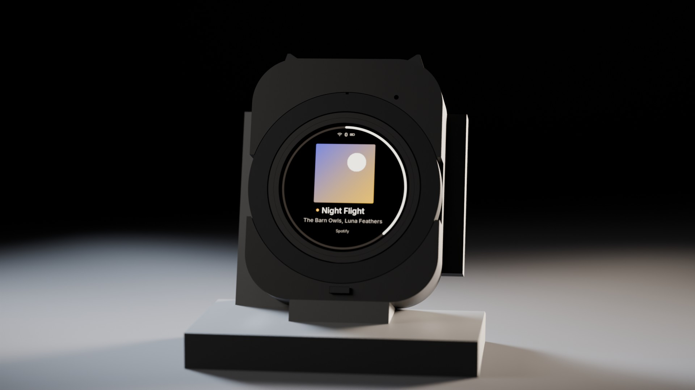
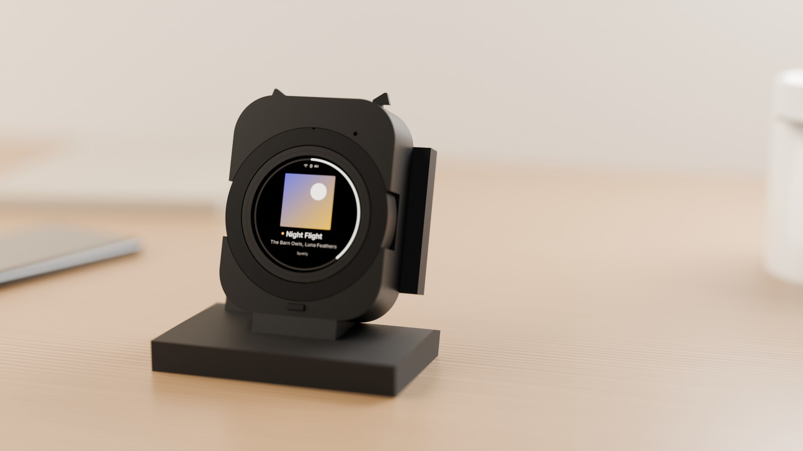
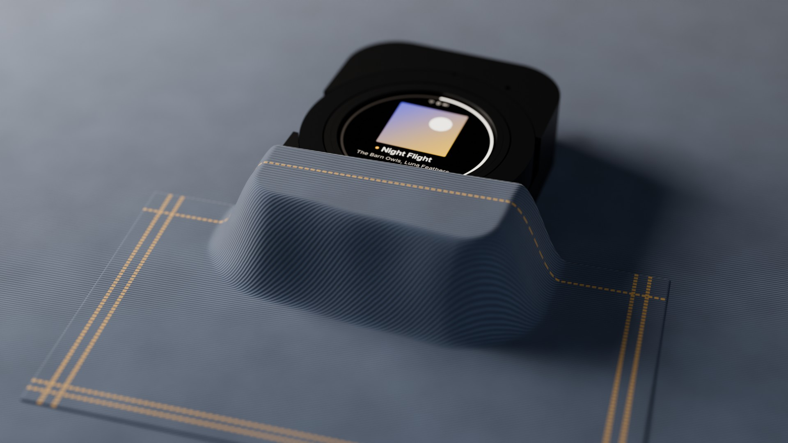
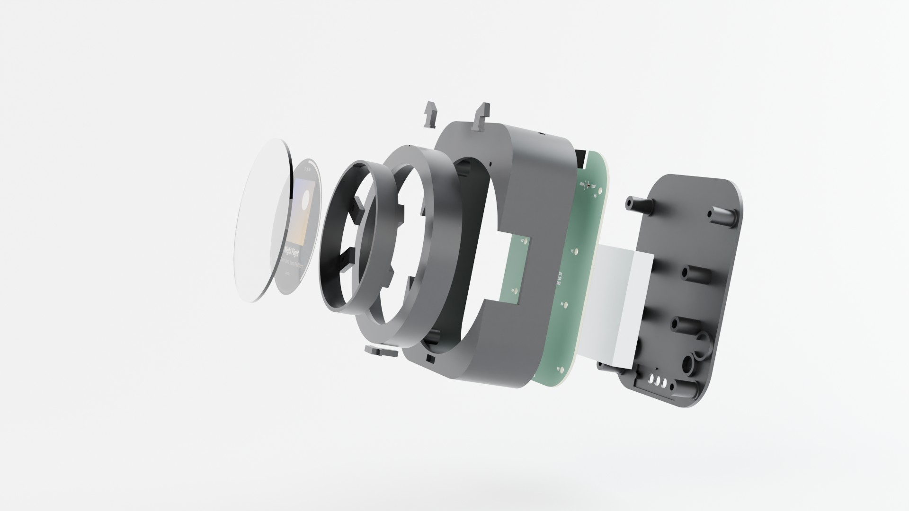

<h1 align="center">OwlTunes</h1>

<b>Your music, one turn away.</b> 
A Spotify remote with a round AMOLED face and a rotating ring. It charges on your desk and goes
with you in your pocket.

<a href="https://danieltyukov.github.io/owltunes/">Website</a> |
<a href="docs/setup-guide.md">Setup guide</a> |
<a href="docs/design/2026-10-04-owltunes-system-design.md">System design</a> |
<a href="docs/hardware/README.md">Hardware</a>

OwlTunes controls the music that is already playing on your phone, laptop or speakers. Turn the
ring to change the volume, tap the cover to pause, press an ear to skip. Drop it on its perch and
it becomes a desk display that charges while it shows what is playing.

Spotify switched off every Car Thing in December 2024. Nobody can do that to OwlTunes: the
firmware, boards and enclosure are open source, it talks to Spotify's Web API directly over Wi-Fi,
and Bluetooth media keys keep working when there is no internet.

| On the desk | In your pocket |
|---|---|
|  |  |

## The device

| | |
|---|---|
| Display | 1.75 inch round AMOLED, 466 x 466, capacitive touch, behind 1.1 mm cover glass |
| Controls | Rotating ring with haptic detents, two ear buttons, a beak button, touch and swipe |
| Brain | ESP32-S3 with 16 MB flash and 8 MB PSRAM |
| Connectivity | Wi-Fi to the Spotify Web API (home network or phone hotspot); Bluetooth LE media keys offline |
| Sensors | Hall sensor for the ring, accelerometer (pick up to wake), ambient light |
| Power | Single-cell LiPo, USB-C, and spring-contact charging on the perch |
| Size | 66 x 84 x 24 mm |
| Perch | Weighted magnetic desk dock that holds the owl at 17.5 degrees |

## How you use it

| Control | Action |
|---|---|
| Ring | Volume on Now Playing; scroll in lists, one haptic tick per item |
| Tap the cover | Play or pause |
| Swipe left or right | Next or previous track |
| Left or right ear | Previous or next track |
| Hold the left ear, turn the ring | Pick one of 8 presets, release to play |
| Hold the right ear | Like the current track |
| Beak | Back; hold for Now Playing |

It also browses your playlists and library, searches, manages the queue and moves playback
between your Spotify Connect devices.

## What it looks like

The screens below come from the desktop simulator, which runs the same UI code as the firmware.

| Now playing | Playlists | Preset wheel | Looking for your phone |
|---|---|---|---|
|  |  |  |  |

## Inside

A 4-layer main board (KiCad 10, assembled by JLCPCB) inside a printed nylon enclosure (build123d,
MJF PA12). The ring carries magnets that a Hall sensor on the board reads, and a small linear
motor gives each detent its click. Every board passes ERC, DRC and a check against the enclosure's
mechanical contract in CI.

The renders on this page are made from the same files: the enclosure and board meshes go into
Blender with `tools/render.sh`, and the screen shows the simulator's output. The album art is a
generated placeholder. The renders were computed on the DelftBlue supercomputer of the Delft High
Performance Computing Centre (DHPC, https://www.tudelft.nl/dhpc).

## Status

- **Firmware:** Wi-Fi setup, Spotify linking and playback control run on an ESP32-S3 dev board
  against a real Spotify account, and are tested on the host and in QEMU. Display and touch
  drivers for the rev A board and the Waveshare AMOLED kit build in CI and wait for first light.
- **Owl v0:** the owl built round the Waveshare AMOLED kit, with the ring, ear and beak buttons
  and a 400 mAh cell, ready to order and print ([kit-owl.md](docs/hardware/kit-owl.md)).
- **Hardware rev A:** main board and perch board designed and checked; ordered after owl v0.
- **Enclosure v1:** owl, ring, bezel and perch ready for printing, with the face built around the
  panel's 52.6 mm cover glass.
- **Next:** owl v0 assembled and brought up, the button and ring drivers, then rev A.

Read the [system design](docs/design/2026-10-04-owltunes-system-design.md) for the full picture
and [docs/hardware](docs/hardware/README.md) for the boards.

## Set it up

OwlTunes needs Spotify Premium and your own free Spotify developer app (client ID). It uses the
Authorization Code flow with PKCE, so no client secret is stored on the device or in this
repository. Open the [setup page](https://danieltyukov.github.io/owltunes/setup/) in Chrome or
Edge, connect the owl over USB, add your Wi-Fi networks and client ID, and log in with Spotify.
The [setup guide](docs/setup-guide.md) walks through every step.

## Build it

Commands (Linux with CMake 3.22+, Ninja and a C compiler)

| What | Command |
|---|---|
| Unit tests (with sanitizers) | `tools/test_host.sh` |
| Simulator screenshot tests | `tools/sim.sh` |
| Interactive simulator (needs `libsdl2-dev`) | `cmake -S sim -B build/sim-sdl -G Ninja -DOWL_SIM_SDL=ON && cmake --build build/sim-sdl && build/sim-sdl/owl_sim sdl` |
| Firmware (ESP-IDF v6.1 activated) | `tools/firmware.sh build` |
| Firmware for the Arduino Nano ESP32, and flashing it | `tools/firmware.sh build nano_esp32`, then `tools/firmware.sh flash nano_esp32` |
| Firmware for the owl's rev A board or the Waveshare ESP32-S3-Touch-AMOLED-1.75 kit (display and touch; not yet run on hardware) | `tools/firmware.sh build owltunes_reva` or `tools/firmware.sh build waveshare_amoled_175`, then `flash` with the same board name |
| Hardware tests on the Nano ESP32 (board on USB) | `tools/hil_nano.py --wifi`; with a linked board and your consent, `tools/hil_spotify.py --real-account` |
| Firmware in the QEMU emulator | `tools/qemu_smoke.sh` |
| Setup protocol in QEMU, including a real HTTPS call to Spotify | `tools/qemu_prov_test.py` |
| Setup site: unit and browser tests (Node.js 22) | `cd web && npm ci && npm test && npm run e2e` |
| Setup site: local development server | `cd web && npm run dev` |
| Enclosure tests and exports | see [enclosure/README.md](enclosure/README.md) |
| Hardware checks (KiCad 10) | `tools/hw/check_all.sh` |
| Product renders (Blender 5.2, kicad-cli, uv) | `tools/render.sh` |
| Regenerate the UI fonts (needs Node.js) | `tools/gen_fonts.sh` |

| Path | Contents |
|---|---|
| `firmware/` | ESP-IDF firmware; shared C code in `firmware/components/`, board support in `firmware/boards/` |
| `sim/` | Desktop simulator and golden screenshots |
| `web/` | The setup site (TypeScript and Vite), published on GitHub Pages |
| `enclosure/` | build123d sources for the owl, owl v0 on the Waveshare kit, the ring and the perch |
| `hardware/` | KiCad 10 projects for the owl main board and the perch board |
| `docs/` | Design documents, hardware notes, setup and protocol guides |
| `tools/` | Build, test, style, render and font scripts |

The UI font is [Inter](https://rsms.me/inter/) (SIL Open Font License, see
`firmware/components/owl_ui/fonts/LICENSE-Inter.txt`).

## Licences

- Software: [MIT](LICENSE)
- Hardware and enclosure designs: [CERN-OHL-P-2.0](LICENSE-HARDWARE)

## Not affiliated with Spotify

OwlTunes is an independent, non-commercial project. It is not affiliated with, endorsed by or
sponsored by Spotify. Spotify is a trademark of Spotify AB.
