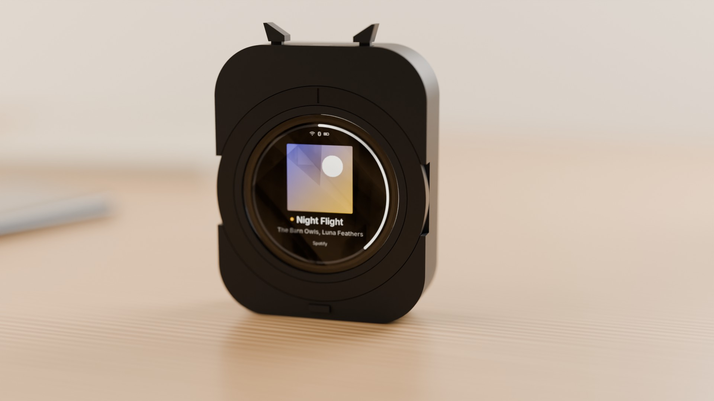
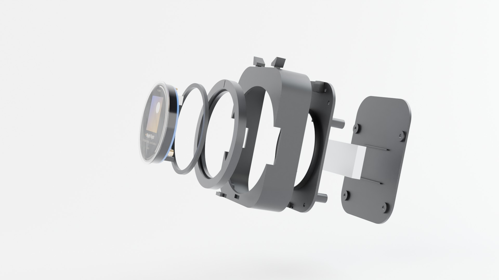
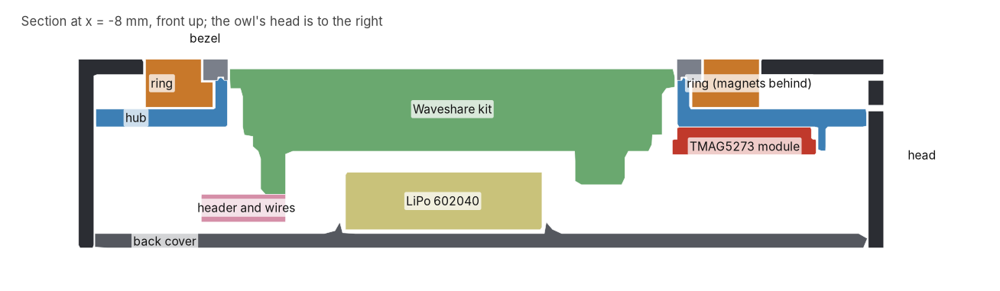

# Owl v0: the owl on the Waveshare kit

Owl v0 is the low-cost way to a working owl: the Waveshare ESP32-S3-Touch-AMOLED-1.75 kit inside
a printed owl, with the turning ring, the two ear buttons and the beak. The kit brings the round
466 x 466 AMOLED with touch, the ESP32-S3 (16 MB flash, 8 MB PSRAM), USB-C and an AXP2101 that
charges a single-cell LiPo, so there is no board to make. Everything else on rev A waits: the
perch and its spring contacts, the haptic motor, the ambient light sensor and the antenna work.
The firmware is the same; the kit's board support is `firmware/boards/bsp_waveshare_amoled_175/`.

The enclosure is `enclosure/owl_kit.py` (66 x 84 x 19.7 mm, the v1 silhouette), checked by
`enclosure/tests/test_owl_kit.py` against envelopes of every bought part.

The renders come from the same files (`tools/render.sh kit kit-exploded`); the kit, the module and
the battery are drawn from the envelopes the tests use.

## Parts

| Part | What to buy | Notes |
|---|---|---|
| Kit | Waveshare ESP32-S3-Touch-AMOLED-1.75, standard version (SKU 31261), not the 1.75C | The speaker in the box is not used; its lead becomes the battery lead |
| Ring sensor | TMAG5273 module, 15 x 20 mm, sensor 2.4 mm from one short edge, 2.7 mm hole in the middle, five pads (GND, INT, SCL, SDA, VCC) at the other end; TMAG5273A1 (40/80 mT), no pin header | The MJKDZ "3D Hall Sensor" board; another layout will not fit the hub |
| Magnets | 24 N52 discs, 3 x 1 mm, axially magnetised (buy 50) | Alternating poles round the ring |
| Switches | 3 tact switches, 3 x 6 x 2.5 mm, two SMD legs | Left ear, right ear, beak |
| Header | One 1 x 8 right-angle male header, 2.54 mm | Plugs into the kit's 8-pin socket |
| Battery | LiPo 602040, 3.7 V, about 400 mAh, with a protection board: 6 x 20 x 40 mm, at most 43 mm long with the protection board | Any plug: it is cut off |
| Screws | 12 M2 x 4 pan head machine screws, black | 3 into the kit's standoffs, 1 for the module, 4 hub to body, 4 cover to hub. They cut their own thread in the 1.7 mm holes of the prints |
| Wire | 30 AWG silicone wire, two colours | About 1.5 m used |
| Also | Solder, a fine soldering tip, heat shrink or tape, gel cyanoacrylate glue, a multimeter | |

## Prints

Six parts, one of each: `body`, `ring`, `bezel`, `hub`, `back_cover`, `beak_key` (STL and STEP from
`uv run --project enclosure python enclosure/owl_kit.py`, in `build/enclosure/kit/`). JLC3DP MJF
PA12 (PA12-HP nylon), dyed black, standard finish, millimetres. JLC3DP takes no part under
2 x 2 x 10 mm, which is why the bezel is 2.2 mm thick and the beak key 10.2 mm long; the tests check
it. Resin (SLA) prints the same files for less, but the screws thread into nylon more reliably and
the ear flexures and the ring wear better in nylon.

## Wiring

Wire by the labels printed next to the kit's header, not by pin number: Waveshare's pin table and
its silkscreen disagree on the order. Seen from the back, the labels read IO18, IO17, IO16, RXD,
TXD, 3V3, GND, VBUS.

| Kit header label | ESP32-S3 | Goes to |
|---|---|---|
| 3V3 | 3.3 V | Module VCC |
| GND | GND | Module GND and one leg of each switch |
| TXD | GPIO43 | Module SCL (I2C1) |
| RXD | GPIO44 | Module SDA (I2C1) |
| IO17 | GPIO17 | Left ear switch, seen from the front |
| IO18 | GPIO18 | Right ear switch |
| IO16 | GPIO16 | Beak switch |
| VBUS | USB 5 V | Not connected |

The switches pull to ground and use the ESP32-S3's internal pull-ups. The module's INT pad stays
free. The module has its own regulator, pull-ups and level shifters, so it runs from 3V3 as it is.
GPIO43 also carries the ROM boot log for a moment after reset; the sensor ignores it.

## Assembly

1. **Firmware first.** Flash the kit over USB before any battery is connected:
   `tools/firmware.sh flash waveshare_amoled_175`. The firmware sets the AXP2101's charge current to
   200 mA (0.5 C of the 400 mAh cell); Waveshare does not document the factory default.
2. **Magnets.** Press 24 magnets into the pockets on the ring's back, flush, with a drop of gel
   glue each. The poles alternate: every pocket with a small dimple beside it takes the same pole
   up. Check each one against a loose magnet before the glue sets.
3. **Switches.** Solder two wires to each switch. Glue the ear switches into the pockets on top of
   the hub's two seats, plunger up; glue the beak switch into the pocket on the hub's front face
   under the ring, plunger forwards. Pass the wires through the holes beside them.
4. **Ring sensor.** Solder four wires to the module (VCC, GND, SDA, SCL). Lay it on the hub's back
   at 12 o'clock with the parts side towards the hub, its sensor end against the short fence and
   its edge against the long one, and fix it with an M2 x 4 screw through its hole.
5. **Beak key.** Drop it into its slot from inside the body, flange inside.
6. **Hub.** Put the hub into the body from behind and fix it with four M2 x 4 screws, which sit in
   counterbores in the hub's back.
7. **Ring.** Slide the ring onto the hub's tube from the front, magnets towards the hub.
8. **Bezel.** Put a thin line of gel glue on the tube's front face, beside the centring ridge, and
   press the bezel on, groove over the ridge. Keep glue off the ring and turn the ring while the
   glue sets; it must turn freely. A little silicone grease on the tube gives a smoother feel.
9. **Kit.** Slide the kit in through the bezel from the front, USB-C to the left and the header at
   the bottom, and fix it from behind with three M2 x 4 screws into its standoffs. They are 3.5 mm
   long: a longer screw can reach the display.
10. **Header.** Solder the wires to the right-angle header's legs as in the table, then plug it into
    the kit's socket with the legs pointing down.
11. **Battery.** Cut the speaker's lead off at the speaker: the MX1.25 plug on it fits the kit's BAT
    socket. Check which wire lands on the + mark beside BAT before going further, cut the battery's
    plug off one wire at a time, and join red to the + wire under heat shrink. Measure the voltage
    and polarity at the plug before it goes in.
12. **Cover.** Lay the battery between the ribs on the cover, plug it in, route its wires past the
    USB-C opening, and fix the cover with four M2 x 4 screws.

## On arrival, before gluing

- Kit: cover glass 48.96 mm, standoff ends 10.40 mm behind the glass front, USB-C mouth 23.8 mm from
  the centre on the left. These come from Waveshare's drawing and photos (owl_params `KIT_*`).
- Module: 15 x 20 mm, sensor centre 2.4 mm from its edge, hole 9.5 mm from the sensor.
- Dry-fit the hub, ring and bezel and turn the ring before any glue goes on.

## Firmware still to write

Display and touch are in place, and the charge current is set. The buttons and the ring are wired
as above and their drivers come at bring-up: GPIO16, 17 and 18 as inputs with pull-ups, and the
TMAG5273 at address 0x35 on I2C1 (SCL GPIO43, SDA GPIO44), read as an angle that turns once for
every pair of magnets (`owl_ring_update` in `owl_gesture.h`).
